# Claude Mods

Fun and slightly unhinged mods for Claude Code.



**New here? → [Quick Start](QUICKSTART.md)** (2 minutes, includes a no-risk `/haunt-demo`)

```
/plugin marketplace add choaticpixels/HauntedClaudeMod
/plugin install haunted-repo@claude-mods
```

| Mod | What it does |
| --- | --- |
| [👻 haunted-repo](plugins/haunted-repo) | Deleted files come back as ghosts that whisper their lost code. Seances, exorcisms, poltergeists and easter eggs. |
| [🛡️ commit-guard](plugins/commit-guard) | Blocks `git commit`/`push` when the change contains secrets, private keys, `.env` files or giant files. |
| [🔁 stuck-detector](plugins/stuck-detector) | Spots retry loops, nudges Claude to change approach, and stops runaway repeats. |
